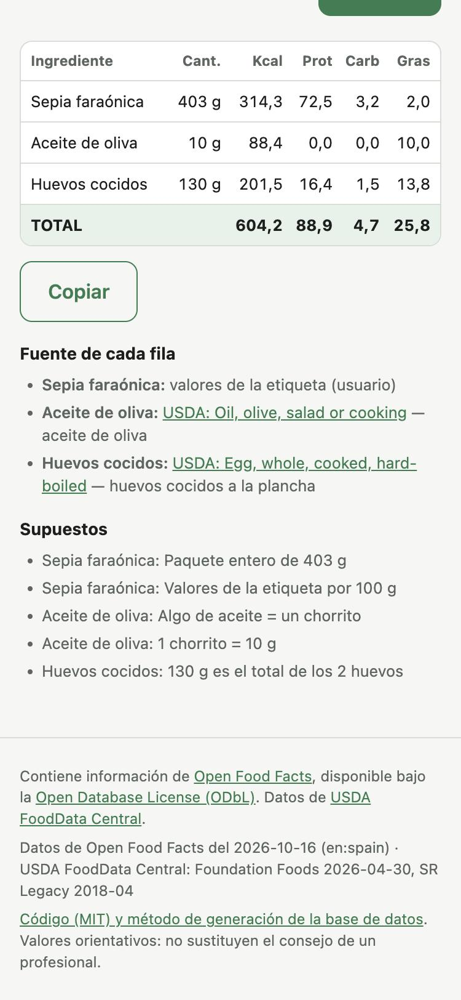

# Macro Translator

Type what you ate in plain Spanish. Get a macro table (kcal, protein, carbohydrate, fat)
that you can copy into a calorie-tracking app (Zepp and others).

> "sepia Hacendado, el paquete de 403 g, algo de aceite en la sartén, huevos cocidos, 2, 130g"



**The LLM never calculates and never invents nutrition values.** It only reads the text and
chooses a food from a list that the backend gives it. The backend does all the arithmetic
with deterministic code and the open data of Open Food Facts and USDA FoodData Central.

Single use: no accounts, no history, no stored requests. Each request is independent.

## Resumen en español

Macro Translator es una aplicación web autoalojable. Escribes en lenguaje natural lo que has
comido y recibes una tabla de macros (Ingrediente | Cantidad | Kcal | Prot | Carbs | Grasas,
con fila TOTAL) optimizada para el móvil, con un botón para copiarla.

- El LLM solo interpreta el texto (ingredientes, cantidad tal como la escribes, estado y
  supuestos) y elige el alimento entre los candidatos que le da el programa.
- El programa convierte las cantidades a gramos, escala los valores por 100 g, suma y
  redondea. Un alimento sin candidato válido sale como "no encontrado": no se estima.
- Los datos vienen de Open Food Facts (productos envasados, filtrados por país) y de USDA
  FoodData Central (alimentos genéricos). Cada usuario genera su base de datos con el ETL.
- Funciona con cualquier endpoint compatible con OpenAI, también con modelos locales
  pequeños (probado con Qwen3.5-9B y gpt-oss-20b).

Inicio rápido: copia `.env.example` a `.env`, configura el LLM, ejecuta
`docker compose --profile etl run --rm etl` y después `docker compose up -d`.
Abre <http://localhost:8000>.

## How it works

```
text ──► 1. Interpret (LLM call 1) ──► ingredients, quantity as written, state, assumptions
                                         │  backend: quantity -> grams (10 ml oil -> 9.2 g)
                                         ▼
         2. Search (DuckDB full-text) ──► 5 candidates from the preferred source
                                         │  brand -> Open Food Facts first, generic -> USDA first
                                         ▼
         3. Select (LLM call 2) ────────► one candidate key or null for each ingredient
                                         │  null -> second round with the other source
                                         ▼
         4. Calculate (backend) ────────► value_100g × grams / 100, totals, coherence check
```

- Label values that the user types ("78 kcal, 18 g de proteína por 100 g") win over the
  database.
- The LLM output is always validated with Pydantic. On an error the backend asks again (max
  2 times) and gives the error to the model.
- No native tool calling. The backend uses `response_format` (JSON schema or JSON object)
  when the server supports it, and extracts the JSON from the text when it does not.
- The prompts are in [`backend/prompts/`](backend/prompts) as Markdown files.

## Requirements

- Docker with Docker Compose 2.24 or later.
- About 10 GB of free disk for the first ETL run (the Open Food Facts dump is 7.95 GB).
- An OpenAI-compatible LLM endpoint: a local server (LM Studio, Ollama, llama.cpp, vLLM,
  mlx-lm) or a hosted provider.

## Quick start

1. Get the code and make your configuration:

   ```bash
   git clone https://github.com/ivanol55/macro-translator.git
   cd macro-translator
   cp .env.example .env
   ```

2. Set `LLM_BASE_URL` and `LLM_MODEL` in `.env` (see [Configure the LLM](#configure-the-llm)).

3. Build the database. The first run downloads about 8 GB and takes about 5–10 minutes:

   ```bash
   docker compose --profile etl run --rm etl
   ```

4. Start the app:

   ```bash
   docker compose up -d
   ```

5. Open <http://localhost:8000>.

## Configure the LLM

The API key stays in the backend. The browser never receives it.

| Server | `LLM_BASE_URL` (from Docker) | `LLM_MODEL` example | Notes |
|---|---|---|---|
| LM Studio | `http://host.docker.internal:1234/v1` | `qwen3.5-9b` | Start the server in LM Studio (Developer tab). |
| Ollama | `http://host.docker.internal:11434/v1` | `qwen3.5:9b` | `ollama serve`, then `ollama pull` the model. |
| llama.cpp | `http://host.docker.internal:8080/v1` | `gpt-oss-20b` | `llama-server -m model.gguf --jinja` |
| mlx-lm | `http://host.docker.internal:8081/v1` | full model path | `mlx_lm.server --model <path> --port 8081` |
| Hosted (OpenAI example) | `https://api.openai.com/v1` | `gpt-5-mini` | Set `LLM_API_KEY`. Any OpenAI-compatible provider works. |

Leave `LLM_API_KEY` empty for local servers.

**Thinking models.** Models such as Qwen3/Qwen3.5 can "think" for a long time before they
answer. If your server supports it, turn thinking off with `LLM_EXTRA_BODY`. The backend
adds this JSON to each request:

```bash
LLM_EXTRA_BODY={"chat_template_kwargs":{"enable_thinking":false}}
```

**Servers without JSON mode.** `LLM_RESPONSE_FORMAT=auto` tries `json_schema`, then
`json_object`, then plain text. Set it to `none` if your server fails in an unexpected way.

## Open it from your phone

1. Set `BIND_ADDRESS=0.0.0.0` in `.env`.
2. Run `docker compose up -d` again.
3. On the phone, open `http://<IP of the computer on your LAN>:8000`.

The "Copiar" button works on plain HTTP too: the page uses a fallback when
`navigator.clipboard` is not available.

> **Security.** The app has no login. By default it listens only on `127.0.0.1`. Open it
> only on a network that you trust. For the internet, put it behind a reverse proxy with
> HTTPS and authentication, and read the obligations in [DATA_LICENSES.md](DATA_LICENSES.md).

## Refresh the data

Run the ETL again. It downloads only the files that changed, then builds the database from
zero and replaces it in one step. The running app opens the new file on its next request.

```bash
docker compose --profile etl run --rm etl
```

Every Monday at 04:00 with cron:

```cron
0 4 * * 1 cd /path/to/macro-translator && docker compose --profile etl run --rm etl >> etl.log 2>&1
```

Open Food Facts updates its dump often. USDA publishes Foundation Foods about
twice a year. SR Legacy does not change.

## Configuration

All settings are environment variables. [`.env.example`](.env.example) lists all of them.

| Variable | Default | Use |
|---|---|---|
| `LLM_BASE_URL` | `http://host.docker.internal:1234/v1` | OpenAI-compatible endpoint |
| `LLM_API_KEY` | empty | Key for hosted providers |
| `LLM_MODEL` | `qwen3.5-9b` | Model name |
| `LLM_TIMEOUT_SECONDS` | `180` | Time limit for one LLM request |
| `LLM_RESPONSE_FORMAT` | `auto` | `auto`, `json_schema`, `json_object` or `none` |
| `LLM_MAX_RETRIES` | `2` | Extra attempts after a validation error (0–2) |
| `LLM_MAX_TOKENS` | empty | Optional `max_tokens` |
| `LLM_EXTRA_BODY` | empty | JSON added to each LLM request |
| `BIND_ADDRESS` | `127.0.0.1` | `0.0.0.0` opens the app to the LAN |
| `APP_PORT` | `8000` | Port on the host |
| `MAX_INPUT_CHARS` | `2000` | Maximum text length |
| `DEBUG` | `0` | `1` logs request text and LLM output |
| `DATA_VOLUME` | `macro-data` | Docker volume name, or a host path such as `./data` |
| `OFF_COUNTRY_TAG` | `en:spain` | Open Food Facts country filter (`countries_tags`) |
| `OFF_LANG` | `es` | Preferred product-name language |
| `OFF_PARQUET_URL` | Hugging Face dump | Open Food Facts source |
| `USDA_FOUNDATION_URL` | newest release | Empty = newest release on the FDC download page |
| `USDA_SR_LEGACY_URL` | 2018-04 release | SR Legacy source |
| `ETL_FORCE_DOWNLOAD` | `0` | `1` downloads everything again |
| `DUCKDB_MEMORY_LIMIT` | empty | Optional ETL memory limit, for example `4GB` |

The app logs no request content unless `DEBUG=1`.

## The data

The ETL ([`etl/build_db.py`](etl/build_db.py)) is a Python script with DuckDB. It has no
orchestrator. It caches the downloads in the data volume, continues interrupted downloads,
checks the SHA-256 of the Open Food Facts dump, and builds the database from zero on each run.

Cleaning rules (both sources):

- Keep only rows with kcal, protein, carbohydrate and fat per 100 g.
- Remove rows with kcal > 900 per 100 g or with negative values.
- Remove rows where |P×4 + C×4 + F×9 − kcal| > 20 % of kcal. A floor of 5 kcal per
  100 g keeps foods near 0 kcal (water, diet drinks).
- Remove rows where protein + carbohydrate + fat > 100 g per 100 g.
- USDA energy: nutrient 1008. If 1008 is missing (Foundation Foods), Atwater specific
  factors (2048), then Atwater general factors (2047).

Tables: `alimentos` (the foods), `indice_off` and `indice_usda` (one DuckDB full-text index
for each source: Spanish and English stemming), `metadata` (download date, source URL,
country filter, rows before and after cleaning).

## Acceptance test results

Run on 2026-10-16 on an Apple M5 MacBook with 24 GB, with the full data and the app in Docker.

Input:

> sepia faraónica Hacendado, el paquete entero de 403 g, la etiqueta pone por 100 g 78 kcal,
> 18 g proteína, 0,8 g hidratos, 0,5 g grasa. Algo de aceite de oliva en la sartén. Huevos
> cocidos, 2, 130g

Result (identical with both models):

| Ingrediente | Cantidad | Kcal | Prot | Carbs | Grasas | Source |
|---|---:|---:|---:|---:|---:|---|
| Sepia faraónica | 403 g | 314,3 | 72,5 | 3,2 | 2,0 | label values (user) |
| Aceite de oliva | 10 g | 88,4 | 0,0 | 0,0 | 10,0 | USDA: Oil, olive, salad or cooking |
| Huevos cocidos | 130 g | 201,5 | 16,4 | 1,5 | 13,8 | USDA: Egg, whole, cooked, hard-boiled |
| **TOTAL** | | **604,2** | **88,9** | **4,7** | **25,8** | |

Expected: ~604 / ~88.9 / ~4.6 / ~25.8. All values are within ±2 % (carbohydrate: +1.7 %).

| Model | Server | JSON mode | Reference case | `tests/test_live_llm.py` |
|---|---|---|---|---|
| gpt-oss-20b (MXFP4) | llama.cpp `llama-server` | `json_schema` | pass, 32 s | 3/3 pass |
| Qwen3.5-9B (MLX 8-bit) | `mlx_lm.server`, thinking off | none: JSON extracted from text | pass, 42 s | 3/3 pass |

The live tests also check: "huevos, 2, 130g" = 130 g, "2×130 g" = 260 g, "10 ml de aceite"
= 9.2 g, and "unicornio a la plancha" = "no encontrado".

Database built from the full data:

| Source | Rows in the source | With the 4 values | After cleaning |
|---|---:|---:|---:|
| Open Food Facts (`en:spain`) | 359,818 | 261,506 | 239,947 |
| USDA Foundation Foods (2026-04-30) | 469 | 377 | 342 |
| USDA SR Legacy (2018-04) | 7,793 | 7,793 | 7,474 |

- Database size: **25.4 MB** (`macros.duckdb`, 247,763 foods with search indexes).
- Download: 7.95 GB in about 5 minutes. Build from the cache: about 5 s (native) or 20 s
  (Docker on Colima).

## Limitations

- Alcoholic drinks fail the coherence rule (alcohol gives 7 kcal/g), so the ETL removes them.
- Many Spanish oils give values per 100 ml in Open Food Facts. For generic oil the app
  prefers USDA (per 100 g).
- The quality of the food choice depends on the model. Read the "Fuente de cada fila" list
  under the table.
- The app has no login and no rate limit.

## Development

```bash
uv sync
uv run pytest                      # tests with fixtures and a fake LLM
uv run ruff check . && uv run ruff format --check .

# Build the database without Docker (writes ./data/macros.duckdb)
uv run python etl/build_db.py

# Run the app without Docker on http://127.0.0.1:8000
LLM_BASE_URL=http://127.0.0.1:1234/v1 LLM_MODEL=qwen3.5-9b \
  PYTHONPATH=backend uv run python -m macro_translator

# Run the pipeline from the terminal
LLM_BASE_URL=http://127.0.0.1:1234/v1 LLM_MODEL=qwen3.5-9b \
  uv run python scripts/cli.py "huevos cocidos, 2, 130g"

# Acceptance tests against a real model
LIVE_LLM=1 DB_PATH=data/macros.duckdb LLM_BASE_URL=http://127.0.0.1:1234/v1 \
  LLM_MODEL=qwen3.5-9b uv run pytest tests/test_live_llm.py
```

See [CONTRIBUTING.md](CONTRIBUTING.md).

## Licences

- **Code:** MIT, see [LICENSE](LICENSE).
- **Open Food Facts data:** Open Database License (ODbL) 1.0 and Database Contents License
  (DbCL) 1.0. The database that the ETL makes is a derivative database under the ODbL.
- **USDA FoodData Central data:** public domain (CC0 1.0).
- This repository does not contain or distribute the database or the dumps. Each user builds
  them with the ETL. The footer of the app always shows the attribution of both sources.

[DATA_LICENSES.md](DATA_LICENSES.md) has the details, the USDA citation, and the obligations
for a public instance.

Values are approximate. They do not replace the advice of a health professional.
